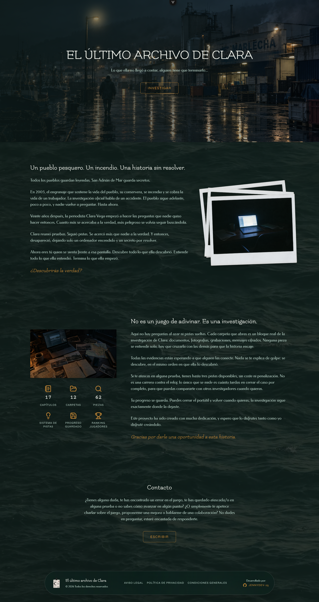
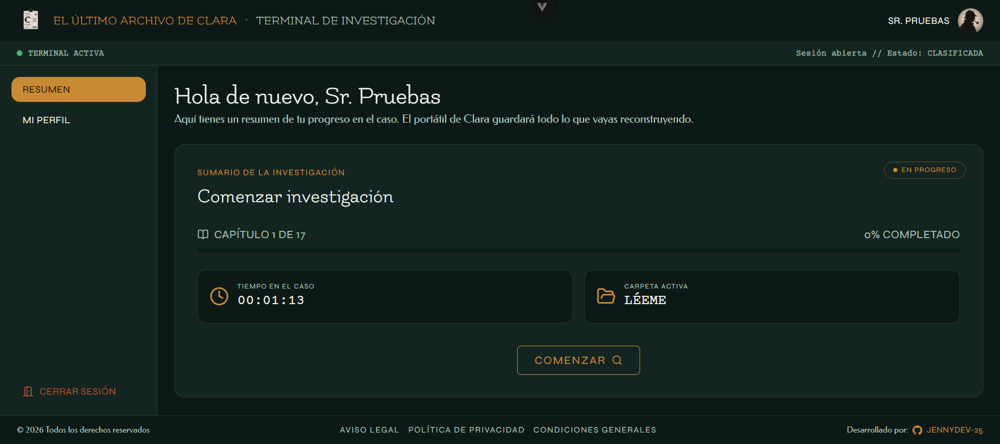
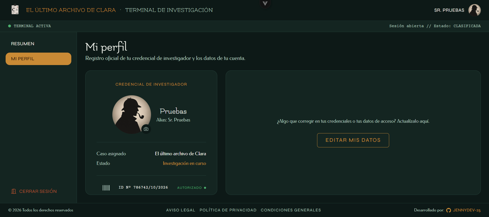
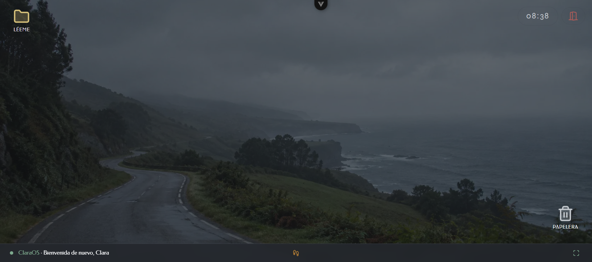
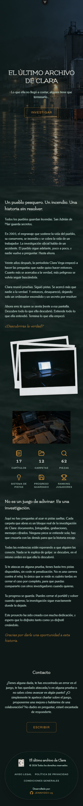
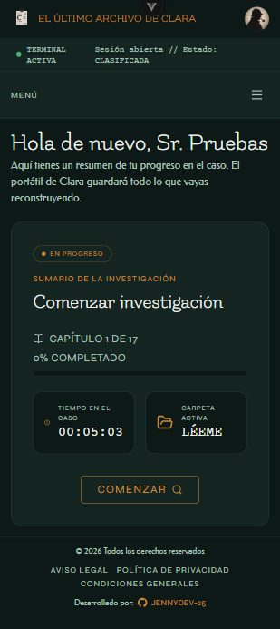
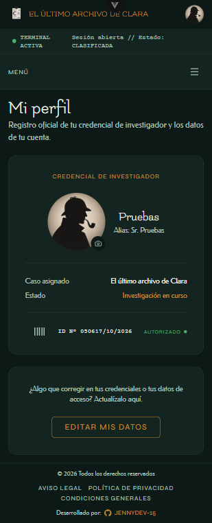
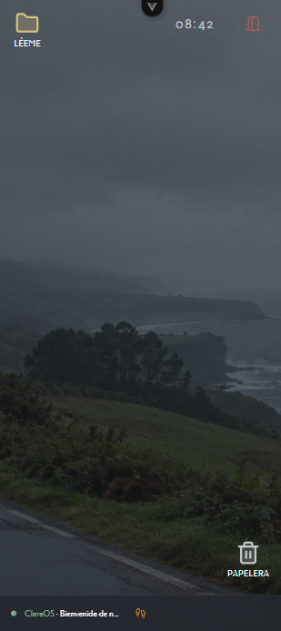
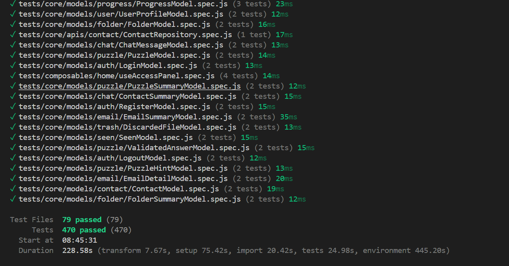
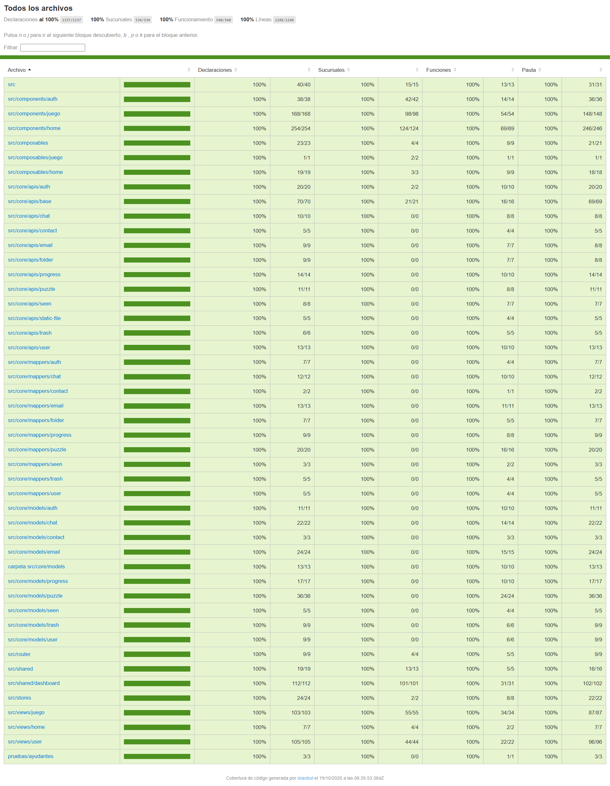

# 🔍 El Último Archivo de Clara · Frontend

> Si estás buscando a Clara, estás empezando por el final.

**Aplicación web** construida con **Vue 3** para _El último archivo de Clara_, un escape room narrativo de investigación. Desarrollada con **Vite**, **Vue Router** y **Pinia**, estilizada con **Tailwind CSS**, consume la API REST del backend con **fetch** y está verificada con **Vitest** y **Vue Test Utils**.

---

## 📸 Vista rápida

### 🖥️ Desktop

| 🏠 Home | 📋 Resumen | 👤 Mi perfil | 🖥️ Escritorio ClaraOS |
| :---: | :---: | :---: | :---: |
|  |  |  |  |

### 📱 Mobile

| 🏠 Home | 📋 Resumen | 👤 Mi perfil | 🖥️ Escritorio ClaraOS |
| :---: | :---: | :---: | :---: |
|  |  |  |  |

### 🧪 Calidad

| 🧪 Tests | 📊 Cobertura |
| :---: | :---: |
|  |  |

---

## 📑 Índice

- [Descripción](#-descripción)
- [Cómo reproducir](#-cómo-reproducir)
- [Pantallas y rutas](#-pantallas-y-rutas)
- [Estructura](#-estructura)
- [Testing](#-testing)
- [Cobertura](#-cobertura)
- [Diseño y gestión del proyecto](#-diseño-y-gestión-del-proyecto)
- [Siguientes pasos](#-siguientes-pasos)
- [Tecnologías](#-tecnologías)
- [Autora](#-autora)
- [Aviso](#-aviso)

---

## 📋 Descripción

Interfaz web del escape room _El último archivo de Clara_. El jugador se hace pasar por investigador, entra en el portátil de Clara (**ClaraOS**) y avanza capítulo a capítulo resolviendo pruebas escondidas en sus carpetas, correos y chats.

Es la contraparte frontend de [`escape-room-clara-backend`](https://github.com/Jennydev-25/escape-room-clara-backend), con quien se comunica mediante una API REST autenticada con **JWT**. La sesión (token y refresh token) se guarda en el store de Pinia y se renueva sola cuando el token caduca.

El proyecto tiene dos mundos visuales con sus propias variables de diseño:

- **Tema público**: la web de presentación (Home, acceso, resumen y perfil), en tonos verdes oscuros y ámbar.
- **Tema ClaraOS**: el escritorio del juego, que imita un sistema operativo con ventanas, carpetas y una papelera.

Sigue una arquitectura **por vistas y componentes reutilizables**, con la lógica de acceso a la API separada en repositorios (`core/apis`), modelos y mappers (`core/models`, `core/mappers`), y estado global en Pinia. Se ha desarrollado con **TDD** en la lógica y los componentes.

[Volver al índice](#-índice)

---

## 🚀 Cómo reproducir

### Requisitos

- **[Node.js](https://nodejs.org/)** `^22.18.0` o `>=24.12.0`
- **El backend en marcha**: sigue los pasos de [escape-room-clara-backend](https://github.com/Jennydev-25/escape-room-clara-backend#-cómo-reproducir). Por defecto la API queda en `http://localhost:8080/api/v1`.

### Pasos

1. **Clona el repositorio**

   ```bash
   git clone https://github.com/Jennydev-25/escape-room-clara-frontend.git
   cd escape-room-clara-frontend
   ```

2. **Instala las dependencias**

   ```bash
   npm install
   ```

3. **Crea el archivo `.env`** a partir de `.env.example`:

   ```env
   VITE_API_URL=http://localhost:8080/api/v1
   VITE_RECAPTCHA_SITE_KEY=tu_clave_de_sitio_de_recaptcha
   ```

   | Variable | Para qué sirve |
   | --- | --- |
   | `VITE_API_URL` | URL base de la API del backend |
   | `VITE_RECAPTCHA_SITE_KEY` | Clave **de sitio** (pública) de [Google reCAPTCHA](https://developers.google.com/recaptcha/docs/display), para el registro y el formulario de contacto |

4. **Arranca el servidor de desarrollo**

   ```bash
   npm run dev
   ```

   La aplicación queda en `http://localhost:5173`, el origen que el backend permite por CORS.

### Scripts

| Comando | Qué hace |
| --- | --- |
| `npm run dev` | Servidor de desarrollo con Vite |
| `npm run build` | Genera la versión de producción en `dist/` |
| `npm run preview` | Sirve la versión de producción en local |
| `npm run test:unit` | Tests unitarios con Vitest |
| `npm run test:coverage` | Tests con informe de cobertura |
| `npm run test:e2e` | Tests end-to-end con Playwright |

[Volver al índice](#-índice)

---

## 🧭 Pantallas y rutas

| Ruta | Pantalla | Acceso |
| --- | --- | :---: |
| `/` | **Home**: portada, historia, sobre el juego, contacto y panel de acceso (Login, Registro y Completar perfil) | Público |
| `/resumen` | **Resumen** del expediente y botón para comenzar la investigación | 🔒 Sesión |
| `/perfil` | **Mi perfil**: credencial de investigador y edición de los datos de la cuenta | 🔒 Sesión |
| `/escritorio` | **ClaraOS**: escritorio del juego con carpetas, ventanas de pruebas y papelera | 🔒 Sesión |

Las rutas con 🔒 usan un _navigation guard_ (`meta.requiresAuth`) que redirige al Home si no hay sesión iniciada, y muestran una pantalla de carga mientras se recupera el expediente.

[Volver al índice](#-índice)

---

## 📁 Estructura

```text
escape-room-clara-frontend/
├── index.html
├── vite.config.js
├── vitest.config.js
├── playwright.config.js
├── public/                       # favicons y manifest
├── e2e/                          # tests end-to-end (Playwright)
├── tests/                        # tests unitarios (espejo de src/)
└── src/
    ├── main.js / App.vue
    ├── router/                   # rutas y guard de autenticación
    ├── stores/                   # Pinia: sesión (auth) y elementos vistos (seen)
    ├── views/
    │   ├── home/                 # HomeView
    │   ├── user/                 # ResumenView, ProfileView
    │   └── game/                 # GameView (escritorio ClaraOS)
    ├── components/
    │   ├── home/                 # Header, Hero, Story, About, Contact, AccessPanel…
    │   ├── auth/                 # LoginForm, RegisterForm, CompleteProfileForm
    │   └── game/                 # FolderList, FolderWindow, PuzzleWindow, TrashWindow, FileViewer, WelcomeCard
    ├── shared/                   # BaseButton, BaseWindow, PasswordField, layout del dashboard
    ├── composables/              # useRecaptcha, useAccessPanel, useScrollSpy…
    ├── core/
    │   ├── apis/                 # repositorios que llaman a la API (BaseRepository + uno por recurso)
    │   ├── models/               # modelos del dominio
    │   └── mappers/              # respuesta de la API → modelo
    └── assets/                   # imágenes, vídeos y estilos (variables de los dos temas)
```

[Volver al índice](#-índice)

---

## 🧪 Testing

Desarrollado con **TDD** (🔴 Red → 🟢 Green → 🔵 Refactor), con el historial `test:` → `feat:` → `refactor:` y el patrón **AAA** (Arrange · Act · Assert). Los tests unitarios están en `tests/`, con la misma estructura que `src/`, y cubren repositorios, mappers, stores, composables, componentes y vistas con **Vitest** y **Vue Test Utils** en un entorno **jsdom**.

```bash
npm run test:unit
```

En total son **470 tests unitarios repartidos en 79 archivos**.

### Tests end-to-end

Con **Playwright** hay **14 tests e2e** (7 en escritorio y 7 en móvil, Pixel 5) en `e2e/`: la Home, las rutas protegidas (sin sesión devuelven a la Home) y el flujo completo del jugador contra el backend real (login, resumen, botón Comenzar y escritorio de ClaraOS).

```bash
npm run test:e2e
```

El test del flujo necesita el backend en marcha y un jugador de prueba registrado a mano con un email ficticio. Sus credenciales se pasan solo por variables de entorno y no se guardan en ningún archivo:

```bash
E2E_EMAIL=<email> E2E_PASSWORD=<contraseña> npm run test:e2e
```

Sin esas variables, el test del flujo se salta y el resto se ejecuta con normalidad.

[Volver al índice](#-índice)

---

## 📊 Cobertura

La cobertura se mide con `@vitest/coverage-v8`:

```bash
npm run test:coverage
```

Además del resumen en consola, genera un informe en HTML en `coverage/index.html`.

La cobertura de los tests unitarios es del **100 %** en sentencias, ramas, funciones y líneas. Los tests e2e no miden cobertura de código.

[Volver al índice](#-índice)

---

## 🎨 Diseño y gestión del proyecto

- **Diseño UI/UX en Figma**: [Escape Clara](https://www.figma.com/design/wiiCZkqZoBAzPclGI6Bm0c/Escape-Clara?node-id=0-1), con tres páginas: **Prototipo** (las pantallas originales y sus vistas móvil), **Mockups** (todas las pantallas en escritorio y móvil) y **Wireframes** (los bocetos en blanco y negro).
- **Gestión del proyecto en Jira**: [Escape Clara (ERC)](https://jennydev25.atlassian.net/jira/software/projects/ERC/boards/498/backlog), con las épicas, los sprints y el backlog del proyecto.
- **Presentación del proyecto**: [Ver la presentación](https://docs.google.com/presentation/d/1mt6UVJjKZdi9443tSGyKDziFnDb-eR43/edit?usp=sharing)
- **Tipografías**: Flamenco (títulos), Federo (texto), Syne (etiquetas) y Courier Prime (monoespaciada).
- **Backend**: [escape-room-clara-backend](https://github.com/Jennydev-25/escape-room-clara-backend). Sus diagramas (entidad-relación de Chen, patas de gallo, clases, secuencia y casos de uso) están en el [README del backend](https://github.com/Jennydev-25/escape-room-clara-backend#-diagramas).
- **Flujo de trabajo**: Gitflow (`main` ← `dev` ← `feature/...`) con commits atómicos y [Conventional Commits](https://www.conventionalcommits.org/es/).

[Volver al índice](#-índice)

---

## 🔭 Siguientes pasos

El **MVP** cubre la Home con el panel de acceso, el Resumen, el Perfil y el escritorio ClaraOS con sus carpetas, pruebas y papelera, con los **capítulos 1 a 3** jugables. Queda anotado como refinamiento:

- Apps del escritorio: Chat, Correo, Notas del jugador y HUD.
- Resto de capítulos de la historia y nuevos tipos de prueba.
- Ranking de jugadores y vistas de administración (perfil, jugadores, detalle y progreso general), ya diseñadas en Figma.
- Más tests end-to-end, con los flujos de registro, perfil y las pruebas del escritorio.
- Despliegue en un hosting gratuito.

[Volver al índice](#-índice)

---

## 🛠️ Tecnologías

- **[Vue 3](https://vuejs.org/)**: Framework de la interfaz, con Composition API (`<script setup>`)
- **[Vite](https://vite.dev/)**: Entorno de desarrollo y build del proyecto
- **[Vue Router](https://router.vuejs.org/)**: Enrutado entre las vistas y guard de autenticación
- **[Pinia](https://pinia.vuejs.org/)**: Gestión del estado global (sesión del jugador, elementos vistos)
- **[Fetch API](https://developer.mozilla.org/es/docs/Web/API/Fetch_API)**: Cliente HTTP para consumir la API REST del backend, con cabecera JWT y renovación automática del token
- **[Tailwind CSS](https://tailwindcss.com/)**: Estilos basados en utilidades, junto con variables CSS para los dos temas
- **[GSAP](https://gsap.com/)**: Animaciones de la web
- **[Lenis](https://lenis.darkroom.engineering/)**: Scroll suave
- **[Lucide](https://lucide.dev/)**: Iconos (`@lucide/vue`)
- **[Google reCAPTCHA](https://developers.google.com/recaptcha)**: Protege el registro y el formulario de contacto
- **[Vitest](https://vitest.dev/)**: Framework de tests unitarios (TDD)
- **[Vue Test Utils](https://test-utils.vuejs.org/)**: Utilidades oficiales para testear componentes Vue
- **[jsdom](https://github.com/jsdom/jsdom)**: Entorno de navegador simulado para los tests
- **[Playwright](https://playwright.dev/)**: Tests end-to-end
- **[npm](https://www.npmjs.com/)**: Gestor de dependencias y scripts del proyecto
- **[Figma](https://www.figma.com/)**: Diseño UI/UX, mockups y prototipo
- **[Git](https://git-scm.com/)** / **[GitHub](https://github.com/)**: Control de versiones y alojamiento del proyecto

[Volver al índice](#-índice)

---

## 👩‍💻 Autora

**[Jenny Sánchez Requejo](https://github.com/Jennydev-25)**

[Volver al índice](#-índice)

---

## ⚠️ Aviso

Este es un proyecto personal, hecho para aprender y para mi portfolio, sin ánimo de lucro.

**Todo el contenido del juego es ficticio.** Los personajes, sus nombres y sus conversaciones, las empresas, los periódicos y los lugares, los hechos y las fechas, los correos, las facturas y demás documentos, las cifras, los importes y las pruebas son inventados. Cualquier parecido con personas reales, con empresas, organizaciones, noticias o sucesos reales es pura coincidencia.

[Volver al índice](#-índice)
